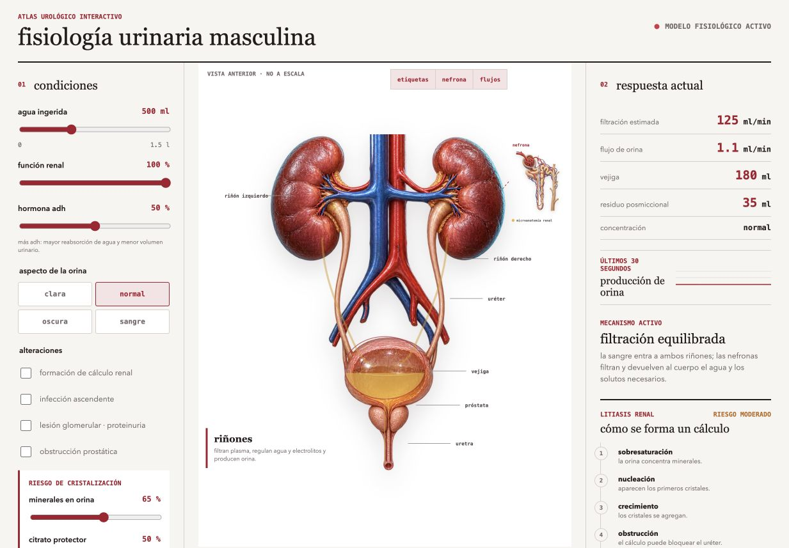

# sistema urinario interactivo

simulación web del sistema urinario masculino con anatomía realista y respuesta fisiológica en tiempo real.

permite explorar hidratación, función renal, hormona adh, concentración de orina, proteinuria, infección ascendente, obstrucción prostática y formación de cálculos renales.



## ejecutar

```bash
npm install
npm run dev
```

## fuentes médicas

- [función renal — niddk](https://www.niddk.nih.gov/health-information/kidney-disease/kidneys-how-they-work)
- [cálculos renales — niddk](https://www.niddk.nih.gov/health-information/urologic-diseases/kidney-stones/definition-facts)

modelo educativo simplificado; no sustituye una valoración médica.
